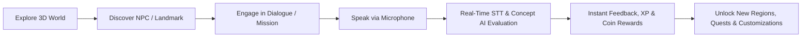

# MINDA (മിണ്ട്) 🌍🗣️

> **Don't just learn. Speak.**  
> An immersive open-world language learning adventure where players explore interactive 3D environments, converse with AI-powered NPCs, complete real-world missions, and acquire practical language skills through gameplay.

[](https://trymindas.vercel.app)
[](https://react.dev/)
[](https://www.typescriptlang.org/)
[](https://threejs.org/)
[](https://tailwindcss.com/)
[](https://vitejs.dev/)

---

## 🌟 Overview

Traditional language learning apps rely heavily on rote memorization, repetitive flashcards, and decontextualized multiple-choice drills. While this helps build vocabulary, it creates a massive "confidence chasm" when learners step into the real world and need to actually speak.

**MINDA** bridges that gap. By combining an interactive 3D virtual world with real-time voice interaction and contextual AI evaluations, MINDA puts learners in realistic everyday scenarios—from ordering chai at a roadside stall in Kerala to asking for directions, negotiating in local markets, and completing day-to-day quests.

---

## 🎯 The Problem MINDA Solves

| Traditional Language Apps | MINDA's Approach |
| :--- | :--- |
| **Passive Tap & Match**: Tap tiles and match words. | **Active Voice-First**: Speak aloud into your mic with real-time level meters and feedback. |
| **Isolated Sentences**: "The apple is on the table." | **Contextual Exploration**: Order tea at a stall, interact with shopkeepers, and navigate towns. |
| **Fear of Speaking**: Anxious about mispronouncing to locals. | **Safe Simulator**: Practice freely with patient, interactive 3D AI characters. |
| **Rigid Answers**: Only exact strings are marked correct. | **Concept-Based AI Evaluation**: Evaluates semantic intent, key concepts, and conversational flow. |

---

## 🎮 How MINDA Works



1. **Explore the 3D World:** Move freely through vibrant, stylized 3D environments featuring dynamic day/night cycles, pedestrians, ambient soundscapes, and interactive landmarks.
2. **Accept Missions & Meet NPCs:** Talk to diverse locals (tea stall vendors, station attendants, locals) who speak the target language.
3. **Listen & Speak:** Hear authentic spoken audio, practice pronunciation with companion guides, and respond using your microphone (with typed fallback).
4. **Instant Evaluation:** The engine parses spoken phrases to verify semantic accuracy, key concept usage, and vocabulary match.
5. **Progression & Rewards:** Earn Experience Points (XP), collect coins, unlock achievements, maintain streaks, and purchase cosmetics or hint tokens in the inventory.

---

## 🚀 Key Features

### 🌆 1. Open-World 3D Gameplay
- **Exploration & Navigation:** Walk, run, and discover landmarks in a 3D environment crafted with **Three.js**, **React Three Fiber**, and **Drei**.
- **Living World Systems:** Dynamic day/night illumination cycles, autonomous pedestrian wanderers, procedural vehicle traffic, and procedural Web Audio ambient soundscapes.
- **Regions & Environments:** Starting in a Kerala-inspired townscape, with visual artwork and mission frameworks designed for multicultural regions (Kerala, Tamil Nadu, Karnataka, France, Japan, Spain).

### 🤖 2. AI-Powered NPC Conversations
- Contextual multi-turn dialogue trees tailored to practical situations:
  - *Chai Stall Ordering* (requesting sugar level, snacks, paying)
  - *Directions & Transportation* (asking where the bus stand or ferry is)
  - *Marketplace Bargaining & Inquiries*
- Dynamic companion mascot **Minu** offers hints, pronunciations, and encouragement along the way.

### 🎙️ 3. Voice-First Interaction & Sarvam AI Integration
- **Speech-to-Text (STT):** High-accuracy speech capture supporting both browser-native speech recognition (`SpeechRecognition`) and server-backed **Sarvam AI (Saaras STT)** for Indic languages.
- **Text-to-Speech (TTS):** Natural speech generation powered by browser synthesis or **Sarvam AI (Bulbul TTS)** voice models for authentic regional accents and phrasing.
- **Evaluation Engine:** Dual-mode assessment:
  - **Local On-Device Concept Matcher:** Levenshtein-tolerant fuzzy concept evaluation for offline/demo reliability.
  - **Remote AI Evaluator:** Optional backend pipeline utilizing **Google Gemini** for contextual feedback and grammatical guidance.

### 🏆 4. Missions, XP, Inventory & Streaks
- **Multi-Phase Units:** Every learning unit features *Vocabulary Practice*, *Sentence Building*, *Active Conversation*, and *Mastery Challenges*.
- **Gamified Economy:** Earn coins and XP to unlock cosmetic upgrades, avatar customizations, and hints.
- **Local Persistence:** All progress, streaks, achievements, coin balances, and conversation logs persist securely in browser storage (`minda-save-v1`).
- **Multilingual UI:** Seamless toggle between English, Malayalam, and Hindi interface localizations.

---

## 🛠️ Technology Stack

| Layer | Technologies |
| :--- | :--- |
| **Frontend Framework** | [React 19](https://react.dev/), [TypeScript 5.9](https://www.typescriptlang.org/) |
| **Build & Tooling** | [Vite 8](https://vitejs.dev/), [pnpm](https://pnpm.io/) |
| **Styling & Motion** | [Tailwind CSS v4](https://tailwindcss.com/) with `@tailwindcss/vite`, [Framer Motion](https://www.framer.com/motion/) |
| **3D Engine** | [Three.js](https://threejs.org/), [@react-three/fiber](https://docs.pmnd.rs/react-three-fiber), [@react-three/drei](https://github.com/pmndrs/drei) |
| **State Management** | [Zustand 5](https://github.com/pmndrs/zustand) with localStorage persistence |
| **Icons & Assets** | [Lucide React](https://lucide.dev/) |
| **Voice & Audio** | Web Speech API, Web Audio API (procedural audio & microphone metering) |
| **AI Backend Contracts**| [Sarvam AI SDK](https://sarvam.ai/) (Saaras STT, Bulbul TTS) & [Google Gemini](https://ai.google.dev/) (Evaluation) |
| **Deployment** | [Vercel](https://vercel.com/) |

---

## 📸 Screenshots

*(Visual previews of MINDA in action)*

| 3D Exploration World | NPC Voice Conversation |
| :---: | :---: |
|  |  |
| *Immersive 3D environments with dynamic lighting* | *Real-time microphone input and AI feedback* |

---

## 💻 Getting Started & Local Development

### Prerequisites
- **Node.js**: v20 or higher
- **Package Manager**: [pnpm](https://pnpm.io/) (recommended) or npm

### Installation

1. **Clone the repository:**
   ```bash
   git clone https://github.com/ashubrothaaa007/mindas.git
   cd mindas
   ```

2. **Install dependencies:**
   ```bash
   pnpm install --frozen-lockfile
   ```

3. **Start the local development server:**
   ```bash
   pnpm dev
   ```
   Open your browser and navigate to `http://localhost:8443` (or the port indicated in your terminal).

4. **Production Build & Preview:**
   ```bash
   pnpm run build
   pnpm run preview
   ```

---

## 🔐 Environment Variables & Security

MINDA is designed with security best practices: **no API keys, provider credentials, or database secrets are ever stored in frontend source code or committed to Git.**

To connect an optional production backend for cloud STT (Sarvam AI), TTS (Bulbul), and Gemini evaluation:

1. Copy the example environment file:
   ```bash
   cp .env.example .env.local
   ```
2. Configure the backend endpoint URL:
   ```env
   # Optional backend endpoint (e.g., Supabase Edge Functions or custom server)
   VITE_MINDA_API_URL=https://your-minda-api-backend.example.com
   ```

> [!IMPORTANT]
> Keep all provider credentials (e.g. `SARVAM_API_KEY`, `GEMINI_API_KEY`) on your private server. Never prefix private secret keys with `VITE_`, as all `VITE_` variables are compiled into the client-side JavaScript bundle.

---

## 🌐 Live Deployment

MINDA is continuously deployed to Vercel:

- **Live URL:** [https://trymindas.vercel.app](https://trymindas.vercel.app)
- **Framework Preset:** Vite
- **Build Output:** `dist`

---

## 🔮 Future Improvements

- [ ] **Multi-Region Expansion:** Add fully interactive 3D assets and mission packs for Tokyo, Paris, Madrid, and Barcelona.
- [ ] **Authoritative Backend:** Introduce Supabase authentication and server-validated reward distribution.
- [ ] **Multiplayer Social Spaces:** Allow friends to explore virtual towns and practice conversations cooperatively.
- [ ] **Mobile Touch Controls:** Optimize virtual joysticks and responsive layouts for mobile and tablet browsers.
- [ ] **Advanced Pronunciation Scorer:** Phoneme-level acoustic scoring comparing user input to native speaker wave patterns.

---

## 📄 License

This project is created for educational and language learning innovation. All rights reserved. For commercial use, licensing inquiries, or partnerships, please contact the maintainer.
